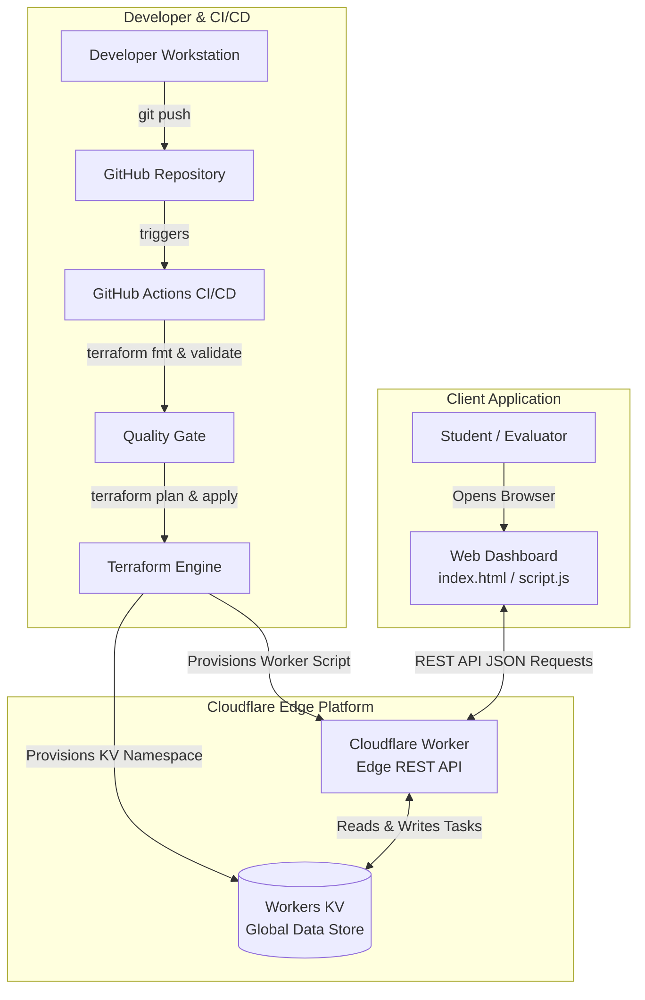

# Automated Deployment of a Serverless Student Task Management Application Using Terraform

An academic mini-project demonstrating **Infrastructure as Code (IaC)**, **Serverless Edge Computing**, **Distributed Key-Value Storage**, and **Automated CI/CD Pipelines** using HashiCorp Terraform, Cloudflare Workers, Cloudflare Workers KV, and GitHub Actions.

---

## 📌 Executive Summary & Architecture

Modern cloud software engineering prioritizes **serverless architectures** and **declarative Infrastructure as Code (IaC)** to eliminate manual server provisioning, reduce operational overhead, and achieve instant global scalability.

This project provisions and automates a full-stack, distributed **Student Task Management Application**:
- **Infrastructure as Code**: Terraform provisions all serverless resources declaratively with zero manual dashboard clicks.
- **Compute Layer**: Cloudflare Workers runs a serverless JavaScript REST API directly on Cloudflare's global edge network (<50ms latency worldwide).
- **Persistence Layer**: Cloudflare Workers KV stores and indexes student assignments, priorities, and deadlines across 300+ edge data centers.
- **Frontend Layer**: Responsive, modern web application (HTML5, Vanilla CSS design system, and JavaScript) with live connection status, search, filters, and offline demo support.
- **CI/CD Automation**: GitHub Actions runs format validation, configuration checks, and automated Terraform deployments upon every push to the `main` branch.

### Architecture Workflow



---

## 🗂️ Project Directory Structure

```text
student-task-manager-iac/
├── terraform/                      # Infrastructure as Code (Terraform)
│   ├── providers.tf                # Terraform required providers & Cloudflare configuration
│   ├── main.tf                     # KV namespace, Worker script & subdomain resources
│   ├── variables.tf                # Configurable input variables & validation rules
│   ├── outputs.tf                  # Exported resource IDs, script names, and endpoints
│   └── terraform.tfvars.example    # Template for local credentials (never committed)
├── application/                    # Application Source Code
│   ├── worker.js                   # Serverless REST API logic for Cloudflare Workers
│   ├── index.html                  # Student Task Manager web application interface
│   ├── style.css                   # Custom CSS styling (Dark mode, glassmorphism)
│   └── script.js                   # Frontend controller (API integration & mock mode)
├── .github/
│   └── workflows/
│       └── deploy.yml              # GitHub Actions automated deployment workflow
├── screenshots/                    # Evaluation artifacts & submission screenshots
│   └── README.md                   # Guide on required screenshots for project report
├── .gitignore                      # Prevents committing credentials, tfvars, and state
└── README.md                       # Academic project documentation and guide
```

---

## 🛠️ File Purpose Breakdown

| File Path | Component | Purpose & Description |
| :--- | :--- | :--- |
| `terraform/providers.tf` | IaC Engine | Declares Terraform version `>= 1.5.0` and configures the `cloudflare/cloudflare` provider (`~> 4.52.0`). |
| `terraform/variables.tf` | IaC Configuration | Declares input parameters (`cloudflare_account_id`, `worker_name`, `kv_namespace_name`, `environment`, `cloudflare_api_token`) with type safety and validation. |
| `terraform/main.tf` | IaC Resources | Defines the core infrastructure: `cloudflare_workers_kv_namespace`, `cloudflare_worker_script` with `TASKS_KV` binding, and `cloudflare_workers_script_subdomain`. |
| `terraform/outputs.tf` | IaC Telemetry | Exposes generated values such as the KV namespace ID, script name, and endpoint URLs for downstream automation. |
| `terraform/terraform.tfvars.example` | IaC Template | A template showing the required variables. Users copy this to `terraform.tfvars` locally without checking secrets into Git. |
| `application/worker.js` | Edge Compute | Serverless ES module script handling CORS, `/api/health`, and full CRUD operations (`GET`, `POST`, `PUT`, `DELETE` on `/api/tasks`) backed by Workers KV. |
| `application/index.html` | Presentation | Semantic, accessible HTML5 dashboard featuring metric cards, task creation form, search toolbar, and status indicators. |
| `application/style.css` | Styling | Responsive Vanilla CSS design system utilizing modern dark mode, glassmorphic cards, typography, and micro-interactions. |
| `application/script.js` | Client Logic | Asynchronous client interacting with the Worker API, state management, search/filter logic, and an offline Demo/Mock mode. |
| `.github/workflows/deploy.yml` | CI/CD Pipeline | Multi-stage GitHub Actions workflow executing `terraform fmt`, `terraform validate`, `terraform plan`, and `terraform apply`. |
| `.gitignore` | Security Guard | Excludes Terraform state files (`*.tfstate`), credentials (`*.tfvars`), and IDE artifacts from version control. |
| `screenshots/` | Documentation | Dedicated folder for capturing verification proofs for project viva, evaluation, and lab manuals. |

---

## 🚀 Step-by-Step Setup & Deployment Guide

> [!IMPORTANT]
> Do not put actual API tokens or Account IDs in source files. Follow the instructions below to use local variables or GitHub Secrets safely.

### 1. Prerequisites
- [HashiCorp Terraform](https://developer.hashicorp.com/terraform/install) (v1.5.0 or newer)
- A free [Cloudflare Account](https://dash.cloudflare.com/sign-up)
- Git & a modern web browser

### 2. Obtain Cloudflare Credentials
1. Log in to the [Cloudflare Dashboard](https://dash.cloudflare.com/).
2. Copy your **Account ID** from the right-hand panel of the dashboard home screen.
3. Navigate to **My Profile > API Tokens > Create Token**.
4. Select the **Edit Cloudflare Workers** template, or create a custom token with:
   - `Account` > `Workers Scripts` > `Edit`
   - `Account` > `Workers KV Storage` > `Edit`
   - `Account` > `Account Settings` > `Read`
5. Copy the generated **API Token**.

### 3. Local Provisioning with Terraform

```bash
# Navigate to the terraform directory
cd terraform

# Create your local secrets file from the template
cp terraform.tfvars.example terraform.tfvars

# Edit terraform.tfvars with your actual Account ID and API Token:
# cloudflare_account_id = "your_actual_account_id"
# cloudflare_api_token  = "your_actual_api_token"

# Initialize Terraform plugins
terraform init

# Validate configuration syntax
terraform validate

# Inspect the planned infrastructure changes
terraform plan

# Apply the configuration to Cloudflare
terraform apply
```

Upon successful completion, Terraform outputs will display your deployed worker script name:
```text
Apply complete! Resources: 3 added, 0 changed, 0 destroyed.

Outputs:
environment = "dev"
kv_namespace_id = "xxxxxxxxxxxxxxxxxxxxxxxxxxxx"
kv_namespace_title = "student-task-manager-dev-kv"
worker_script_name = "student-task-manager-dev"
workers_dev_enabled = true
```

---

### 4. Running the Frontend Application & Edge Serving

This project employs a **Unified Serverless Architecture**:
- When deployed via Terraform, **Cloudflare Worker** serves both the **static web frontend** (`/`, `/style.css`, `/script.js`) and the **REST API** (`/api/*`) directly from Cloudflare's edge memory.
- You can visit `https://student-task-manager-dev.<your-subdomain>.workers.dev/` directly in any web browser to use the full application immediately!

#### Local Testing Options:

**Option A: Using Python's built-in HTTP server:**
```bash
python -m http.server 8080 --directory application
# Open http://localhost:8080 in your browser
```

**Option B: Using Node's npx serve:**
```bash
npx -y serve application -p 8080
# Open http://localhost:8080 in your browser
```

**Option C: Direct Browser Launch:**
Double-click `application/index.html` to open it in your browser.

---

### 5. Automated CI/CD with GitHub Actions

The repository includes a production-grade CI/CD pipeline ([deploy.yml](file:///d:/student-task-manager-iac/.github/workflows/deploy.yml)) featuring:
- **Pull Request Quality Gate**: Runs `terraform fmt -check`, `terraform init`, and `terraform validate` without applying any infrastructure changes.
- **SHA-Pinned Actions**: Uses immutable commit SHAs for third-party GitHub Actions (`actions/checkout` and `hashicorp/setup-terraform`) for supply-chain security.
- **Controlled Production Deployment**: Triggers only on merges to `main`, requiring explicit environment approval before executing `terraform apply`.
- **Zero Automated Destroy**: `terraform destroy` is strictly excluded from all workflows to prevent data loss.

#### Step 1: Create a New GitHub Repository
1. Log in to [GitHub](https://github.com/) and click **New repository** (or visit [github.com/new](https://github.com/new)).
2. Name the repository `student-task-manager-iac`.
3. Choose **Public** or **Private**.
4. **Important**: Leave "Add a README file", ".gitignore template", and "license" **unchecked** (we already have them configured locally).
5. Click **Create repository**.

#### Step 2: Configure GitHub Actions Secrets
1. In your newly created GitHub repository, click **Settings** (top tab).
2. In the left navigation, select **Secrets and variables** ➔ **Actions**.
3. Under **Repository secrets**, click **New repository secret** and add:
   - **Name**: `CLOUDFLARE_API_TOKEN`
     **Value**: Your Cloudflare API Token (with Workers & KV Edit permissions).
   - **Name**: `CLOUDFLARE_ACCOUNT_ID`
     **Value**: Your 32-character Cloudflare Account ID (`bf3191fe2ff41a2b469b06a494f5bc3f`).

#### Step 3: Configure Environment Protection for Production
1. In repository **Settings**, click **Environments** in the left sidebar.
2. Click **New environment** and enter name: `production`.
3. Under **Environment protection rules**, check **Required reviewers**.
4. Add your GitHub username as an approved reviewer.
5. Click **Save protection rules**.
   *(Now, any deployment to production will pause and wait for your manual click to approve before executing `terraform apply`).*

#### Step 4: Remote State Backend Strategy
> [!IMPORTANT]
> GitHub-hosted runners are ephemeral virtual machines destroyed after every job run. Local state files (`*.tfstate`) do not persist across runner instances.
> 
> To enable automated state tracking in CI/CD without state collision:
> - **Recommended**: Store state in a **Cloudflare R2 Bucket** (S3-compatible, free for 10 GB).
> - Enable the `backend "s3"` block inside [terraform/providers.tf](file:///d:/student-task-manager-iac/terraform/providers.tf) pointing to your R2 bucket endpoint.
> - For academic demonstration without S3, you can use `terraform apply` locally where `terraform.tfvars` manages state, while GitHub Actions validates PR code quality.

#### Step 5: Push the Project to GitHub
Run the following commands in Windows PowerShell:
```powershell
cd d:\student-task-manager-iac

# Stage all tracked files (verifying .gitignore excludes secrets & binaries)
git add .

# Create initial commit
git commit -m "feat: complete serverless student task manager with terraform and ci-cd"

# Set default branch to main
git branch -M main

# Link to your GitHub repository (replace <your-username>)
git remote add origin https://github.com/<your-username>/student-task-manager-iac.git

# Push to GitHub
git push -u origin main
```

#### Step 6: Verify the Workflow
1. Navigate to the **Actions** tab in your GitHub repository.
2. You will see the **CI/CD Pipeline - Terraform & Cloudflare Deployment** workflow running.
3. The `validate-and-plan` job will execute first, checking formatting, initializing, and planning.
4. If pushed to `main`, the `deploy-production` job will prompt for your environment approval before running `terraform apply`.

---

## 📡 REST API Reference & Testing Examples

The deployed serverless worker exposes the following RESTful endpoints:

| Method | Endpoint | Description | Request Body |
| :--- | :--- | :--- | :--- |
| `GET` | `/api/health` | Healthcheck & service status metadata | None |
| `GET` | `/api/tasks` | List all tasks (supports `?status=`, `?priority=`, `?search=`) | None |
| `POST` | `/api/tasks` | Create a new student task | JSON object with `title`, `priority`, `status` |
| `GET` | `/api/tasks/{id}` | Fetch details of a single task by ID | None |
| `PUT` | `/api/tasks/{id}` | Update status, priority, or title of a task | JSON object |
| `DELETE` | `/api/tasks/{id}` | Delete a task from Workers KV | None |

### 🧪 Exact `curl` API Test Examples

Replace `WORKER_URL` with your actual worker address (e.g., `https://student-task-manager-dev.<your-subdomain>.workers.dev`):

#### 1. Check API Health
```bash
curl -X GET "https://WORKER_URL/api/health"
```

#### 2. Create a New Task (POST)
```bash
curl -X POST "https://WORKER_URL/api/tasks" \
  -H "Content-Type: application/json" \
  -d '{
    "title": "Complete Cloud Computing Terraform Assignment",
    "priority": "High",
    "status": "Pending"
  }'
```
*Response (HTTP 201 Created):*
```json
{
  "message": "Task created successfully.",
  "task": {
    "id": "task_1729501234_abc12",
    "title": "Complete Cloud Computing Terraform Assignment",
    "priority": "High",
    "status": "Pending",
    "createdAt": "2026-10-21T10:00:00.000Z",
    "updatedAt": "2026-10-21T10:00:00.000Z"
  }
}
```

#### 3. List All Tasks (GET)
```bash
curl -X GET "https://WORKER_URL/api/tasks"
```

#### 4. Fetch a Specific Task by ID (GET)
```bash
curl -X GET "https://WORKER_URL/api/tasks/task_1729501234_abc12"
```

#### 5. Update Task Status or Priority (PUT)
```bash
curl -X PUT "https://WORKER_URL/api/tasks/task_1729501234_abc12" \
  -H "Content-Type: application/json" \
  -d '{
    "status": "Completed",
    "priority": "Medium"
  }'
```

#### 6. Delete a Task by ID (DELETE)
```bash
curl -X DELETE "https://WORKER_URL/api/tasks/task_1729501234_abc12"
```
*Response (HTTP 200 OK):*
```json
{
  "message": "Task deleted successfully.",
  "id": "task_1729501234_abc12"
}
```

---

## 🧹 Infrastructure Teardown (Cost Prevention)

When your academic demonstration or evaluation is complete, remove all provisioned cloud resources cleanly:

```bash
cd terraform
terraform destroy -auto-approve
```

---

## 🔒 Security Best Practices Implemented

1. **Zero Hardcoded Secrets**: No API keys or tokens exist in source code or version control.
2. **Comprehensive `.gitignore`**: Excludes `*.tfstate`, `terraform.tfvars`, credentials, and local environment files.
3. **Sensitive Variable Flag**: The `cloudflare_api_token` variable is marked `sensitive = true`, preventing secrets from being displayed in terminal logs or CI execution logs.
4. **Principle of Least Privilege**: Cloudflare API Token permissions are strictly scoped to Workers and Workers KV.
